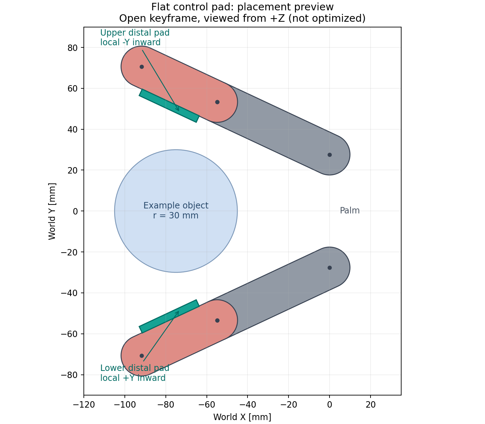

# Shap-E를 이용한 고정 그리퍼의 distal pad 최적화

`assets/design0009.xml` 그리퍼의 양쪽 distal link 안쪽에 대칭 패드를 붙이고, 패드 형상을 Shap-E로 생성·평가·개선하는 실험 코드다. 기존 링크·관절·텐던 설정은 그대로 두고 패드만 추가한다.

```
Shap-E 생성 → 패드 후처리 → 여러 물체 파지 평가 → 우수 후보(elite) 선택 → 조건 임베딩 학습 → 다음 round 생성 → …
```

| 문서 | 내용 |
|---|---|
| `README_ko.md` (이 문서) | 설치, 실행 순서, **스크립트별 설명과 실행 옵션**, 설정 항목, 문제 해결 |
| `EXPERIMENT_GUIDE_ko.md` | 실험 설계: 패드 기하, 후처리, 평가 프로토콜, 성공 조건의 근거 |
| `REFERENCE_MAP_ko.md` | 기존 점프 로봇 코드와 이 코드의 대응 관계 |
| `VERIFICATION.md` | 이 코드에서 실제로 실행·확인한 범위 |



---

## 목차

1. [설치 (Windows PowerShell)](#1-설치-windows-powershell)
2. [처음 실행하는 순서](#2-처음-실행하는-순서)
3. [폴더 구조와 결과 파일](#3-폴더-구조와-결과-파일)
4. [스크립트별 설명과 실행 옵션](#4-스크립트별-설명과-실행-옵션)
5. [padopt 공용 모듈](#5-padopt-공용-모듈)
6. [config.json 설정 항목](#6-configjson-설정-항목)
7. [재실행·이어하기와 서명 검사](#7-재실행이어하기와-서명-검사)
8. [문제 해결](#8-문제-해결)

---

## 1. 설치 (Windows PowerShell)

### 1-1. 가상환경

레포 폴더(이 README가 있는 곳)에서 실행한다. Python 3.11을 권장한다.

```powershell
py -3.11 -m venv .venv
.\.venv\Scripts\Activate.ps1
```

- 프롬프트 앞에 `(.venv)`가 보여야 한다. **새 PowerShell 창을 열 때마다 다시 활성화해야 한다.** 활성화하지 않으면 시스템 Python이 실행되어 `CUDA was requested but is unavailable` 같은 에러가 난다.
- `이 시스템에서 스크립트를 실행할 수 없으므로…` 에러가 나면 `Set-ExecutionPolicy -Scope Process Bypass`를 먼저 실행한다(현재 창에만 적용).
- 활성화 없이 `.\.venv\Scripts\python.exe 스크립트.py …`로 직접 실행해도 된다.

### 1-2. PyTorch (GPU용)을 먼저 설치

`requirements_shap_e.txt`의 `torch>=2.1`을 Windows에서 그대로 설치하면 **CPU 전용 빌드**가 설치된다. 그래서 GPU 빌드를 먼저 설치하고, 그 다음에 나머지 패키지를 설치한다.

GPU 세대에 맞는 CUDA 빌드를 골라야 한다. `nvidia-smi` 오른쪽 위 `CUDA Version`(드라이버가 지원하는 최대 버전)보다 높지 않은 빌드를 고른다. 정확한 명령은 [pytorch.org/get-started](https://pytorch.org/get-started/locally/)에서 확인한다.

| GPU | 필요한 빌드 |
|---|---|
| RTX 50 시리즈 (Blackwell, `sm_120`) | CUDA 12.8 이상 빌드. `cu126` 이하에는 이 GPU용 커널이 없어 `no kernel image is available` 에러가 난다. |
| 그 이전 세대 | 드라이버가 지원하는 CUDA 빌드 |

실험 PC(RTX 5080)에서 동작을 확인한 조합은 `torch 2.14.1+cu130`이다. `torchvision`은 CLIP이 import할 때 필요하므로 **같은 인덱스에서 함께** 설치한다.

```powershell
python -m pip install torch==2.14.1 torchvision==0.29.1 --index-url https://download.pytorch.org/whl/cu130
python -m pip install -r requirements_shap_e.txt
```

설치 확인은 `is_available()`만으로는 부족하다. GPU 세대가 빌드에 포함되어 있는지(`get_arch_list`)와 실제 연산이 되는지까지 본다.

```powershell
python -c "import torch; print(torch.__version__, torch.cuda.get_arch_list()); print(torch.randn(3, device='cuda') * 2)"
```

`device='cuda:0'` 텐서가 에러 없이 출력되면 된다. `requirements_shap_e.txt`의 CLIP 설치에는 Git이 필요하다.

### 1-3. Shap-E 소스

이 코드는 Shap-E를 pip로 설치하지 않고, `--shap-e-dir`(또는 `config.json`의 `shap_e_dir`)가 가리키는 폴더에서 소스를 직접 불러온다. **그 폴더 바로 아래에 `shap_e\` 폴더가 있어야 한다.**

OpenAI 공식 저장소를 권장한다.

```powershell
cd "C:\Users\User\Desktop\BEAR lab"
git clone https://github.com/openai/shap-e.git shap-e-official
```

- 공식 소스는 이 코드가 쓰는 기능(`sample_latents`, `embeddings` 조건 입력, `model.wrapped.clip`, `training_losses`)을 모두 갖고 있고, marching-cubes 임곗값이 원래 값(0)이다.
- `shap-e.zip`의 `shap-e-main_from_johnson\shap-e-main` 사본은 실험 PC에서 생성 첫 단계에 `UnboundLocalError: … 'model_kwargs'`로 멈췄다. 조건 합성 기능을 넣으면서 수정된 `shap_e/diffusion/k_diffusion.py`의 `denoiser`가 원인이다. 이 사본을 꼭 써야 한다면 원본을 직접 고치지 말고 복사본을 수정해서 쓴다(`jumping_diffuse`에서도 쓰는 소스이기 때문).
- zip 최상위의 `shap-e\shap_e`는 marching-cubes 임곗값이 바뀐 사본이라 기본적으로 실행이 거부된다(`--allow-modified-mc` 참고).
- venv에 `pip install shap-e`로 다른 Shap-E를 설치하지 않는다. 설치되어 있으면 `A different Shap-E is already imported` 에러가 난다.

경로를 매번 입력하지 않으려면 `config.json`의 `shap_e_dir`에 적어 둔다. JSON 안에서는 `/`를 쓰는 것이 편하다.

```json
"shap_e_dir": "C:/Users/User/Desktop/BEAR lab/shap-e-official",
```

`config.json` 안의 **상대 경로는 config 파일이 있는 폴더 기준**으로 해석된다. 이렇게 적어 두면 `generate_pads.py`, `optimize_embeddings.py`, `run_optimization.py`에서 `--shap-e-dir`를 생략할 수 있다.

### 1-4. 모델 가중치

처음 실행할 때 `text300M`, `transmitter`, CLIP 가중치를 `config.json`의 `cache_dir`(기본 `model_cache\`)에 내려받는다. 합계 3 GB 이상이며 한 번만 받는다. 이미 받은 캐시가 다른 곳에 있으면 `cache_dir`을 그 위치로 바꾼다. 원본 프로젝트의 `D:\Dataset` 자료는 필요하지 않다.

### 1-5. 설치 점검

```powershell
python inspect_gripper.py
python -m unittest discover -s tests -v
```

unittest 6개는 Shap-E·GPU 없이 기하 처리, XML 조립, 평가 장치, 서명 검사를 확인한다.

---

## 2. 처음 실행하는 순서

아래 예시는 PowerShell 변수에 Shap-E 경로를 넣어 쓴다. `config.json`에 `shap_e_dir`를 적어 두었다면 `--shap-e-dir $SHAPE` 부분을 빼도 된다.

```powershell
$SHAPE = "C:\Users\User\Desktop\BEAR lab\shap-e-official"
```

### 2-1. 대조군 만들기와 평가

```powershell
python make_baselines.py
python evaluate_pads.py --bare --suite train --repeats 3 --out runs/eval_bare
python evaluate_pads.py --candidate runs/baselines/pad_flat --suite train --repeats 3 --out runs/eval_flat
```

물체는 그리퍼가 감쌀 수 있는 크기(손 안쪽 폭 약 55~68 mm)로 골랐고, 링크 4개가 모두 닿는 enveloping 위치에 놓는다(4-12). 학습 조건(300 g, 2 N 펄스)에서 위치 오차를 넣은 `--repeats 3`(24회) 평균 점수는 원본 그리퍼 7.9/15, 평면 패드(3.5 mm) 12.1/15였다(엄격한 성공률은 8%, 50%). 가벼운 조건(`config_light.json`, 100 g, 0.5 N)에서는 둘 다 15/15다.

### 2-2. 후보 2개로 동작 확인

```powershell
python generate_pads.py --round 0 --count 2 --shap-e-dir $SHAPE --device cuda
python preview_pads.py --round-dir runs/round_000 --count 2 --out runs/round_000/preview.png
python preview_mount.py --candidate runs/round_000/pad_0000 --out runs/round_000/mount_pad_0000.png
python view_candidate.py --candidate runs/round_000/pad_0000 --case 4 --slow 4
python evaluate_pads.py --round-dir runs/round_000 --suite train --repeats 1 --out runs/round_000/eval_smoke
```

### 2-3. 후보 늘리기와 첫 round 완료

같은 round에 `--count`만 늘려 다시 실행하면 이미 만든 후보는 건너뛰고 이어서 만든다. 개수는 **`config.json`이 아니라 `--count`로** 바꾼다(이유는 [7장](#7-재실행이어하기와-서명-검사)).

```powershell
python generate_pads.py --round 0 --count 100 --shap-e-dir $SHAPE --device cuda
python evaluate_pads.py --round-dir runs/round_000 --suite train --repeats 3 --out runs/round_000/eval_train
python select_elites.py --summary runs/round_000/eval_train/summary.csv --out runs/round_000/elites.json
python optimize_embeddings.py --elites runs/round_000/elites.json --out runs/round_000/next_embeddings.pt --shap-e-dir $SHAPE --device cuda
python generate_pads.py --round 1 --count 100 --embedding runs/round_000/next_embeddings.pt --shap-e-dir $SHAPE --device cuda
```

`eval_smoke`(repeats 1)와 `eval_train`(repeats 3)은 평가 조건이 다르므로 반드시 다른 `--out` 폴더를 쓴다.

### 2-4. 여러 round 자동 실행

위 과정이 정상 동작하면 `run_optimization.py`로 round 전체를 자동으로 반복할 수 있다.

```powershell
python run_optimization.py --rounds 5 --count 100 --repeats 3 --shap-e-dir $SHAPE --device cuda
```

### 2-5. 최종 설계의 validation과 재생

최종 후보는 **train 결과만으로** 고른 뒤 validation(학습에 쓰지 않은 물체)에서 학습 조건(300 g, 2 N)과 가벼운 조건(100 g, 0.5 N)으로 한 번씩 평가한다. `round_004/pad_0037`은 예시다.

```powershell
python evaluate_pads.py --candidate runs/round_004/pad_0037 --suite validation --repeats 5 --out runs/final_validation
python evaluate_pads.py --config config_light.json --candidate runs/round_004/pad_0037 --suite validation --repeats 5 --out runs/final_light
python view_candidate.py --candidate runs/round_004/pad_0037 --suite validation --case 0
```

---

## 3. 폴더 구조와 결과 파일

### 3-1. 레포 구성

```
gripper_pad_shape/
├─ assets/design0009.xml      기준 그리퍼 MuJoCo 모델
├─ config.json                학습·평가 기본 설정 (물체 300 g, 외란 펄스 2 N × 5방향)
├─ config_light.json          가벼운 조건 확인용 (물체 100 g, 외란 펄스 0.5 N × 5방향)
├─ inspect_gripper.py         패드 설계 영역 치수 확인
├─ make_baselines.py          평면 패드 대조군 생성
├─ generate_pads.py           Shap-E 패드 후보 생성
├─ preview_pads.py            후보·elite 패드 형상 그림 (3D 입체, 두께 지도)
├─ preview_mount.py           open 자세 부착 위치 단면도
├─ build_gripper.py           후보 XML 재생성
├─ calibrate_positions.py     물체를 enveloping(링크 4개 접촉) 위치에 놓도록 x 위치 결정
├─ view_candidate.py          MuJoCo 뷰어로 파지 시험 재생
├─ evaluate_pads.py           여러 물체 파지 평가
├─ select_elites.py           우수 후보 선택
├─ optimize_embeddings.py     조건 임베딩 학습
├─ run_optimization.py        위 과정을 여러 round 자동 반복
├─ padopt/                    공용 모듈 (5장)
├─ tests/test_pipeline.py     unittest 6개
└─ runs/                      결과 폴더 (config의 output_dir)
```

### 3-2. round 폴더 (`runs/round_000/`)

| 파일·폴더 | 만드는 스크립트 | 내용 |
|---|---|---|
| `run.json` | `generate_pads.py` | 이 round의 생성 설정, Shap-E 경로·파일 해시, torch 버전, 서명 |
| `pad_0000/` … | `generate_pads.py` | 후보 하나 = 상·하부에 붙는 대칭 패드 한 쌍 (아래 표) |
| `rejected.jsonl` | `generate_pads.py` | 후처리에서 탈락한 샘플(후보 번호, 시도 번호, seed, 이유) |
| `generation_summary.json` | `generate_pads.py` | 요청 개수와 완료 개수 |
| `eval_train/` | `evaluate_pads.py` | 평가 결과 (아래 표) |
| `elites.json` | `select_elites.py` | 선택된 후보 목록과 등수·지표, 정렬 기준 |
| `ranking.csv` | `select_elites.py` | 평가된 모든 Shap-E 후보의 점수 등수 |
| `next_embeddings.pt` / `.json` | `optimize_embeddings.py` | 다음 round용 조건 임베딩 K×768과 학습 기록 |

### 3-3. 후보 폴더 (`runs/round_000/pad_0000/`)

| 파일 | 내용 |
|---|---|
| `latent.pt` | 패드를 만든 원본 Shap-E 형상 latent (임베딩 학습의 목표값) |
| `condition.pt` | 생성에 쓴 1×768 조건 벡터 (프롬프트의 CLIP 임베딩 또는 임베딩 bank의 한 줄) |
| `raw_shap_e.stl` | 후처리 전 Shap-E mesh (`save_raw_mesh`가 true일 때) |
| `surface.npz` | 길이 격자 `s`, 폭 격자 `z`, capsule 반지름, 두께 지도 `thickness` |
| `pad_upper.stl`, `pad_lower.stl` | 부착용 패드 형상. **단위는 m**라서 mm 단위 CAD로 가져올 때는 1,000배 한다. |
| `gripper_with_pad.xml` | 기준 그리퍼에 패드만 추가한 MuJoCo 모델 |
| `metadata.json` | seed, 프롬프트, 투영 coverage, 두께 범위, 부피·질량, 서명. **이 파일이 있어야 완성된 후보로 인정된다.** |

### 3-4. 평가 폴더 (`eval_train/` 등)

| 파일·폴더 | 내용 |
|---|---|
| `evaluation.json` | 평가 설정과 서명 |
| `records/` | 후보별 결과 캐시. 있으면 다시 계산하지 않는다. |
| `summary.csv` | 후보당 1줄 요약 (`select_elites.py`의 입력) |
| `trials.csv` | 시험당 1줄 상세 기록 |

---

## 4. 스크립트별 설명과 실행 옵션

모든 스크립트는 `-h`로 옵션 목록을 볼 수 있다(`python generate_pads.py -h`). `--config`는 `preview_pads.py`를 제외한 모든 스크립트의 공통 옵션이다.

| 공통 옵션 | 기본값 | 설명 |
|---|---|---|
| `--config` | `config.json` | 설정 파일. 가벼운 조건은 `config_light.json`을 쓴다. |

### 4-1. `inspect_gripper.py` — 패드 설계 영역 확인

기준 XML에서 distal link 치수를 읽고, `config.json`의 `pad` 설정으로 정해지는 패드 크기를 JSON으로 출력한다. Shap-E·MuJoCo를 불러오지 않으므로 설치 직후나 `pad` 설정을 바꾼 뒤 가장 먼저 실행해 본다.

| 옵션 | 기본값 | 설명 |
|---|---|---|
| `--config` | `config.json` | |

출력: distal link 이름·길이·반지름, 패드 길이·폭(mm), capsule 반지름, 패드당 충돌 조각 수.

```powershell
python inspect_gripper.py
```

### 4-2. `make_baselines.py` — 평면 패드 대조군

Shap-E 패드와 비교할 대조군을 만든다. 두께가 일정한 평면 패드를 Shap-E 후보와 같은 위치·폭·재료로 만들고, 원본 그리퍼 XML도 복사해 둔다. 이 대조군은 `source: flat_baseline`으로 표시되어 elite 선택과 임베딩 학습에서 자동으로 제외된다.

| 옵션 | 기본값 | 설명 |
|---|---|---|
| `--config` | `config.json` | |
| `--thickness-mm` | `3.5` | 평면 패드 두께(mm). `pad.thickness_min_mm`~`thickness_max_mm` 범위 안이어야 한다. |

출력: `runs/baselines/bare_gripper.xml`(패드 없는 원본), `runs/baselines/pad_flat/`(후보 폴더와 같은 구성).

```powershell
python make_baselines.py
python make_baselines.py --thickness-mm 2.5
```

### 4-3. `generate_pads.py` — Shap-E 패드 후보 생성

요청한 개수만큼 **유효하고 서로 다른** 패드 후보를 만든다. 후보마다 다음을 수행한다.

1. 조건을 정한다.
   - round 0: `generation.prompts`의 프롬프트를 후보 번호 순서대로 돌아가며 쓴다(후보 번호 % 프롬프트 수).
   - round 1 이후: `--embedding`으로 받은 임베딩 bank의 줄을 돌아가며 쓴다(후보 번호 % K).
2. Shap-E `text300M`으로 형상 latent를 샘플링하고 `transmitter`로 mesh를 디코딩한다.
3. 후처리(`padopt/geometry.py`): mesh를 주성분 축으로 정렬 → 위에서 투영한 높이 지도 추출 → 평활화 → 높이의 2~98% 구간을 두께 범위(기본 1.5~5.5 mm)로 매핑 → 기울기 제한 → capsule에 맞는 닫힌 패드로 변환.
4. 다음 경우는 탈락시키고 seed를 바꿔 다시 샘플링한다: mesh가 잘못됨, 투영 coverage 25% 미만, 거의 평평함, 이미 만든 후보와 같은 표면(20 µm 단위 비교). 탈락 기록은 `rejected.jsonl`에 남는다.
5. `max_attempts_per_candidate`(기본 8)번 안에 유효한 후보를 못 얻으면 멈춘다. 다른 형상으로 대체하지 않는다.

seed는 `generation.seed + round × 10,000,000 + 후보 번호 × 100 + 시도 번호`로 정해져서 같은 설정이면 같은 결과가 나온다.

| 옵션 | 기본값 | 설명 |
|---|---|---|
| `--config` | `config.json` | |
| `--count` | config의 `generation.count` (500) | 만들 후보 수. 이미 완성된 후보는 건너뛰고 나머지만 만든다. |
| `--round` | `0` | round 번호. 결과는 `runs/round_XXX/`에 저장된다. |
| `--embedding` | 없음 | `optimize_embeddings.py`가 만든 임베딩 bank(`.pt`). **round 1 이상에서는 필수**다(실수로 새 무작위 round를 시작하는 것을 막는다). 다른 패드 설정으로 학습된 bank는 거부된다. |
| `--shap-e-dir` | config의 `shap_e_dir` | `shap_e\` 폴더를 **포함하는** 폴더 |
| `--device` | `auto` | `cuda`, `cpu`, `auto`(GPU가 있으면 cuda). `cuda`를 지정했는데 GPU를 못 찾으면 에러로 멈춘다. GPU에서는 fp16으로 샘플링한다. |
| `--allow-modified-mc` | 꺼짐 | marching-cubes 임곗값이 수정된 Shap-E 사본을 일부러 쓸 때만 켠다. 기본은 감지 시 멈춘다. |

시간: RTX 5080에서 샘플링이 후보당 약 6초 걸렸다. 디코딩·후처리·재샘플링이 더해진다.

```powershell
python generate_pads.py --round 0 --count 2 --shap-e-dir $SHAPE --device cuda
python generate_pads.py --round 0 --count 100 --shap-e-dir $SHAPE --device cuda
python generate_pads.py --round 1 --count 100 --embedding runs/round_000/next_embeddings.pt --shap-e-dir $SHAPE --device cuda
```

실행 중 나오는 `custom_fwd`/`custom_bwd`, `torch.jit.load` FutureWarning과 `No module named 'pytorch3d'` 경고는 무시해도 된다. 메시 추출은 PyTorch 기본 렌더러로 정상 처리된다.

### 4-4. `preview_pads.py` — 패드 형상 그림

여러 패드의 형상을 한 장의 PNG로 그린다(한 줄에 4개). Shap-E·MuJoCo 없이 실행된다.

- `--round-dir`: round 폴더의 후보를 번호 순서대로 그린다.
- `--elites`: `select_elites.py`가 만든 `elites.json`의 후보를 **등수 순서대로** 그리고, 제목에 등수·후보 이름·평균 점수·가장 약한 물체 점수를 적는다.
- `--view solid`(기본): **실제 패드 입체 형상**(STL과 같은 모양)을 3D로 그린다. 바닥면은 distal 링크 캡슐(빨간 윤곽선)에 맞춰 굽어 있고, 윗면(물체에 닿는 면)은 두께에 따라 색칠된다. 축은 관절로부터의 거리, 폭(+가 위쪽), 링크 축으로부터의 높이(mm)다.
- `--view surface`: 두께만 3D 표면 그래프로 그린다(바닥을 평평하게 펴서 본 모양).
- `--view map`: 두께 지도. 가로축은 distal 관절로부터의 거리, 세로축은 패드 폭 방향이다. **시뮬레이션에서 폭 방향은 세로(위아래, 중력 방향)이고 Width +가 위쪽이다.**

| 옵션 | 기본값 | 설명 |
|---|---|---|
| `--config` | `config.json` | 색 범위(`pad`의 두께 최소·최대)를 읽는다 |
| `--round-dir` | — | round 폴더 |
| `--elites` | — | `elites.json` 경로 |
| `--count` | `12` | 그릴 후보 수 (round: 번호 앞에서부터, elites: 1등부터) |
| `--view` | `solid` | `solid`(패드 입체), `surface`(두께 3D 그래프), `map`(두께 지도) |
| `--out` | 필수 | 저장할 PNG 경로 |

`--round-dir`와 `--elites` 중 **하나는 반드시** 지정한다.

```powershell
python preview_pads.py --round-dir runs/round_000 --count 12 --out runs/round_000/preview.png
python preview_pads.py --elites runs/round_000/elites.json --out runs/round_000/elites_3d.png
python preview_pads.py --elites runs/round_000/elites.json --view map --out runs/round_000/elites_map.png
```

### 4-5. `preview_mount.py` — 부착 위치 단면도

`open` 자세에서 그리퍼를 위(+Z)에서 본 단면도를 그린다. 링크 capsule, 패드 단면(폭 가운데), 예시 물체(반지름 30 mm)를 함께 그려 패드가 올바른 면에 붙었는지 확인한다.

| 옵션 | 기본값 | 설명 |
|---|---|---|
| `--config` | `config.json` | |
| `--candidate` | 필수 | 후보 폴더 |
| `--out` | 필수 | 저장할 PNG 경로 |

그림 제목은 항상 `Flat control pad`로 표시되지만, 실제로는 지정한 후보의 패드를 그린다.

```powershell
python preview_mount.py --candidate runs/round_000/pad_0000 --out runs/round_000/mount_pad_0000.png
```

### 4-6. `build_gripper.py` — 후보 XML 재생성

후보의 `surface.npz`로 `gripper_with_pad.xml`을 다시 만든다. 생성 때 자동으로 만들어지므로 평소에는 필요 없다. 후보 폴더를 옮겼거나 XML을 다른 위치에 따로 만들고 싶을 때 쓴다. 후보를 만들 때와 같은 기준 XML·`pad` 설정이어야 한다(다르면 거부).

| 옵션 | 기본값 | 설명 |
|---|---|---|
| `--config` | `config.json` | |
| `--candidate` | 필수 | 후보 폴더 |
| `--out` | `<후보>/gripper_with_pad.xml` | 저장할 XML 경로. STL 경로는 이 위치 기준 상대 경로로 기록된다. |

```powershell
python build_gripper.py --candidate runs/round_000/pad_0000
```

### 4-7. `view_candidate.py` — MuJoCo 뷰어로 파지 시험 재생

`evaluate_pads.py`와 **같은 시험 한 번**을 MuJoCo 뷰어로 보여 준다. 실제 속도로 재생하고, 시험이 끝나면 마지막 자세로 창을 유지한다. 화면 왼쪽 위와 터미널에 현재 시각과 단계(닫기, 들어 올리기, 외란 몇 번째와 힘 방향, 측정)가 표시된다. 받침대는 갈색 판으로 보인다. 창을 닫으면 그 시험의 결과(성공 여부, 접촉 비율, 이동량 등)가 출력된다. 시험 자체는 `padopt/evaluation.py`를 그대로 쓰고 재생 속도와 창 유지만 뷰어 쪽에서 처리하므로, 결과는 `evaluate_pads.py`의 같은 시험과 같다.

| 옵션 | 기본값 | 설명 |
|---|---|---|
| `--config` | `config.json` | |
| `--candidate` | 없음 | 후보 폴더. 생략하면 패드 없는 원본 그리퍼로 시험한다. |
| `--suite` | `train` | 물체 세트 (`train`, `validation`) |
| `--case` | `0` | 물체 번호 (아래 표). 범위를 벗어나면 가능한 번호와 이름을 보여 준다. |
| `--repeat` | `0` | 위치 번호. 0은 기준 위치, 1 이상은 평가 때와 같은 흔들린 위치 |
| `--slow` | `1.0` | 재생 배속의 역수. `4`면 4배 느리게, `0`이면 최대 속도 |
| `--no-hold` | 꺼짐 | 시험이 끝나면 창을 바로 닫는다 |

| `--case` | train (x 위치) | validation (x 위치) |
|---|---|---|
| 0 | `cylinder_r28` (-49.0 mm) | `unseen_cylinder_r29` (-53.5 mm) |
| 1 | `cylinder_r31` (-52.0 mm) | `unseen_sphere_r31` (-50.5 mm) |
| 2 | `sphere_r29` (-47.5 mm) | `unseen_box_36x56` (-47.5 mm) |
| 3 | `sphere_r33` (-49.0 mm) | `unseen_box_40x52` (-44.5 mm) |
| 4 | `box_36x52` (-47.5 mm) | `unseen_ellipsoid_64x58` (-41.5 mm) |
| 5 | `box_32x56` (-49.0 mm) |  |
| 6 | `box_30x60` (-50.5 mm) |  |
| 7 | `ellipsoid_60x56` (-47.5 mm) |  |

뷰어에서 `C`를 누르면 접촉점, `F`를 누르면 접촉력이 표시된다. 패드가 실제로 물체에 닿는지 확인할 때 쓴다.

```powershell
python view_candidate.py --candidate runs/round_000/pad_0000 --case 4 --slow 4
python view_candidate.py --candidate runs/baselines/pad_flat --case 4 --slow 4
python view_candidate.py --candidate runs/round_000/pad_0000 --suite validation --case 2 --repeat 3
```

후보의 `gripper_with_pad.xml`을 `python -m mujoco.viewer --mjcf=runs\round_000\pad_0000\gripper_with_pad.xml`로 직접 열어 모양만 볼 수도 있다. 다만 이 XML에는 원본의 큰 물체(반지름 55 mm)가 손가락과 겹친 채로 남아 있어서 물리 시험에는 맞지 않는다. 파지 확인은 `view_candidate.py`로 한다.

### 4-8. `evaluate_pads.py` — 여러 물체 파지 평가

후보마다 물체 세트의 모든 물체를 `--repeats`번씩 잡게 하고 결과를 저장한다. train 8개 물체 × `--repeats 3`이면 **후보 1개당 24번** 시험한다.

**시험 한 번의 순서** (시간은 기본 설정 기준, 시뮬레이션 timestep 1 ms)


| 시간 | 단계 | 일어나는 일 |
|---|---|---|
| 0 s | 시작 | `open` 자세. 물체는 **받침대 위에 그냥 놓여 있다.** 물체를 붙잡는 힘은 없고 처음부터 중력을 받는다. 시작할 때 물체·패드가 0.2 mm 넘게 파고들어 있으면 `initial_overlap`으로 즉시 실패 처리한다(받침대와의 접촉은 제외). |
| 0–1.0 s | 닫기 | 텐던 구동 입력을 0.6초 동안 0 → 20으로 올리고 1.0초까지 닫는다(텐던 힘 최대 10 N). 물체는 받침대 위에서 **밀리고 미끄러질 수 있다.** |
| 1.0–1.5 s | 들어 올리기 | 그리퍼 베이스(`palm`)가 50 mm 올라가고, 동시에 받침대가 30 mm 내려간다. 속도가 0에서 시작해 0에서 끝나는 부드러운 궤적이며 최대 가속도는 약 1 m/s²다. |
| 1.5–4.5 s | 유지 | 그리퍼만으로 물체를 공중에 들고 있다. 2 N 힘 펄스(각 0.3 s, `config_light.json`은 0.5 N)를 +x, −x, +y, −y, −z(아래) 순서로 0.5 s 간격으로 준다. |
| 4.2–4.5 s | 측정 | 마지막 0.3 s 동안 0.01 s마다 양쪽 손가락과 양쪽 패드의 접촉력을 기록한다. |

좌표: 손가락은 −x 방향으로 뻗어 있고(팜이 +x 쪽), y 방향으로 닫히며, z가 위쪽(중력 반대)이다. 패드 폭 방향이 z다.

평가용 모델에만 받침대(`object_support`)와, 들어 올리기용 수직 슬라이드 관절(`lift_slide`)·위치 액추에이터(`lift_actuator`)가 추가된다. 원본 링크·관절·텐던·모터는 그대로이며, 후보 폴더의 `gripper_with_pad.xml`에는 들어가지 않는다.

**점수 (주 결과)**: 외란에서 떨어져도 바로 실패로 보지 않고, 얼마나 오래 버텼는지로 점수를 준다.

| 단계 | 점수 | 판정 시점 |
|---|---|---|
| 들어 올린 뒤 떨어지지 않음 | +5 | 첫 번째 외란이 시작될 때(1.8 s) 아직 잡고 있으면 |
| 외란 1~5를 각각 버팀 | 각 +2 | 그 외란 다음 외란이 시작될 때(마지막 외란은 시험 끝, 4.5 s) 아직 잡고 있으면 |

- 최대 점수는 5 + 2 × 5 = **15점**이다. 한 번 떨어지면 그 뒤 단계는 점수를 받지 못한다. 예를 들어 외란 3(+y) 중에 떨어지면 5 + 2 + 2 = 9점이다.
- **떨어짐**: 닫기가 끝난 순간을 기준으로 물체가 그리퍼 베이스에 대해 15 mm(`drop_distance_mm`) 넘게 움직였거나, 바닥에 닿았거나, 들어 올린 뒤 받침대에 다시 닿은 경우다. 그 시각이 `drop_time_s`로 기록된다.
- 시작 겹침(`initial_overlap`)이나 수치 발산(`simulation_warning`)은 0점이다.
- 점수 기준은 `config.json`의 `evaluation`에 `drop_distance_mm`(기본 15), `score_grasp`(기본 5), `score_per_disturbance`(기본 2)를 넣어 바꿀 수 있다. 넣지 않으면 기본값을 쓴다.

아래 성공 조건은 더 엄격한 참고 지표로 함께 기록된다. 성공한 시험은 항상 15점이다.

**성공 조건 (참고)** (모두 만족)

- 측정 구간 샘플의 90% 이상에서 위쪽 손가락과 아래쪽 손가락이 **둘 다** 0.1 N 이상으로 누르고 있다. 손가락은 proximal·distal 링크와 패드를 모두 포함한다.
- 닫기가 끝난 순간(1.0 s)의 물체 위치를 기준으로, 이후 물체가 **그리퍼 베이스에 대해** 8 mm 넘게 움직이지 않는다. 그리퍼와 함께 올라가는 움직임은 미끄러짐으로 세지 않는다.
- 같은 기준에서 물체가 30° 넘게 돌아가지 않는다. 구는 회전을 보지 않고, 원기둥·캡슐은 축이 기운 각도만 본다.
- 물체가 바닥에 닿지 않고, 들어 올리기가 끝난 뒤 받침대에 다시 닿지 않는다.
- 시뮬레이션이 발산하지 않는다(발산하면 `simulation_warning`으로 실패).

**패드 파지 성공(`pad_success`)**: 위 성공 조건을 만족하면서, 측정 구간 샘플의 90% 이상에서 **위·아래 패드가 둘 다** 0.1 N 이상으로 닿아 있는 경우다. 링크나 손가락 끝만으로 잡은 성공과 구별하기 위한 참고 지표다. `success_requires_pad_contact`를 true로 바꾸면 `success` 자체도 패드 접촉을 요구한다.

**물체 위치**: 물체마다 손가락을 닫았을 때 **링크 4개와 양쪽 패드가 모두 닿는 enveloping 위치**(`position_x_m`)에 놓는다(`calibrate_positions.py`로 정한 값). `repeat 0`은 그 위치 그대로, `repeat 1` 이상은 x ±3 mm, y ±2 mm, yaw ±10° 안에서 흔든 위치다. 흔드는 값은 seed·물체 번호·반복 번호로만 정해지므로 **모든 후보가 똑같은 위치들에서 시험받는다.**

| 옵션 | 기본값 | 설명 |
|---|---|---|
| `--config` | `config.json` | 가벼운 조건은 `config_light.json` |
| `--round-dir` | — | round 폴더의 완성된 후보 전부 평가 |
| `--candidate` | — | 후보 하나만 평가 |
| `--bare` | — | 패드 없는 원본 그리퍼 평가 |
| `--suite` | `train` | `train`(8개 물체) 또는 `validation`(학습에 쓰지 않은 5개 물체) |
| `--repeats` | `3` | 물체마다 시험 횟수. `1`이면 기준 위치만 시험한다. |
| `--limit` | 없음 | 앞에서부터 N개 후보만 평가 |
| `--out` | 필수 | 결과 폴더 |

`--round-dir`, `--candidate`, `--bare` 중 **하나는 반드시** 지정한다.

**결과 지표**

| `trials.csv` 열 | 의미 |
|---|---|
| `status` | `ok`, `initial_overlap`, `simulation_warning` |
| `score`, `max_score` | 점수와 최대 점수(15) |
| `held_after_lift` | 1 = 들어 올린 뒤 첫 외란 전까지 잡고 있음(+5점) |
| `disturbances_survived` | 버틴 외란 수(각 +2점) |
| `drop_time_s` | 떨어진 시각(초). 끝까지 잡고 있었으면 빈칸 |
| `success` | 1 = 엄격한 성공(참고) |
| `pad_success` | 1 = 위·아래 패드로 잡은 성공 |
| `contact_fraction` | 측정 구간에서 양쪽 손가락이 모두 닿아 있던 비율 |
| `pad_contact_fraction` | 측정 구간에서 **위·아래 패드가 둘 다** 0.1 N 이상으로 닿아 있던 비율 |
| `max_drift_mm`, `max_rotation_deg` | 닫기가 끝난 뒤 그리퍼 베이스에 대한 최대 이동량·회전량 |
| `closing_shift_mm` | 닫는 동안 물체가 밀려난 거리 (참고용) |
| `lift_achieved_mm` | 닫기 끝 → 시험 끝 사이 물체 높이 변화. 잘 잡으면 약 +50, 놓치면 음수 |
| `mean_normal_force_N` | 측정 구간의 평균 접촉력 합 |
| `max_tendon_force_N` | 최대 텐던 힘 |
| `floor_contact`, `support_contact` | 바닥 접촉 여부, 들어 올린 뒤 받침대 재접촉 여부 |
| `initial_penetration_mm`, `object_x_m`, `object_y_m`, `object_yaw_deg` | 시작 시 침투량과 물체 위치 |

| `summary.csv` 열 | 의미 |
|---|---|
| `mean_score`, `max_score` | 전체 시험의 평균 점수와 최대 점수(15) |
| `score_rate` | `mean_score / max_score` |
| `worst_object_score` | 물체별 평균 점수 중 가장 낮은 값 |
| `held_after_lift_rate` | 들어 올린 뒤 잡고 있던 시험 비율 |
| `success_rate` | 전체 시험 중 엄격한 성공 비율(참고) |
| `pad_success_rate` | 전체 시험 중 패드 파지 성공 비율 |
| `worst_object_success` | 물체별 성공률 중 가장 낮은 값 |
| `contact_fraction`, `pad_contact_fraction` | 각 열의 평균 |
| `mean_drift_mm` | `max_drift_mm`의 평균 |
| `invalid_trials` | `status`가 `ok`가 아닌 시험 수 (실패로 세고 분모에서 빼지 않는다) |
| `one_pad_volume_m3` | 패드 하나의 부피 |

진행 표시에는 후보마다 `score=12.13/15 success=0.500`처럼 평균 점수가 나온다.

시간: 시험 한 번이 시뮬레이션 4.5초라서 약 1.3초 걸렸다(CPU 1코어, PC에 따라 다름). 후보 100개 × 24번이면 1시간 가까이 걸린다. 중간에 멈춰도 같은 명령으로 다시 실행하면 `records/`에 있는 후보는 건너뛴다.

```powershell
python evaluate_pads.py --round-dir runs/round_000 --suite train --repeats 3 --out runs/round_000/eval_train
python evaluate_pads.py --candidate runs/round_000/pad_0005 --suite validation --repeats 5 --out runs/check_pad_0005_val
python evaluate_pads.py --bare --suite train --repeats 3 --out runs/eval_bare
python evaluate_pads.py --config config_light.json --candidate runs/round_000/pad_0005 --suite validation --repeats 5 --out runs/check_pad_0005_light
```

### 4-9. `select_elites.py` — 우수 후보 선택

`evaluate_pads.py`의 **train** `summary.csv`를 읽어 **점수 순서로 등수**를 매기고 상위 N개를 elite로 고른다.

1. `mean_score` 높은 순 (평균 점수)
2. `worst_object_score` 높은 순 (가장 약한 물체의 평균 점수)
3. `pad_contact_fraction` 높은 순
4. `invalid_trials` 적은 순
5. `mean_drift_mm` 작은 순
6. 패드 부피 작은 순

| 옵션 | 기본값 | 설명 |
|---|---|---|
| `--config` | `config.json` | |
| `--summary` | 필수 | train 평가의 `summary.csv` |
| `--count` | config의 `optimization.elite_count` (12) | elite로 고를 개수 |
| `--out` | 필수 | 저장할 `elites.json` 경로 |
| `--ranking-out` | `--out`과 같은 폴더의 `ranking.csv` | 모든 Shap-E 후보의 등수 표 |
| `--show` | 20 | 화면에 출력할 상위 등수 개수 |

출력:
- 화면: 상위 등수 표. `*` 표시가 elite다.
- `ranking.csv`: 모든 후보의 `rank`, 평균 점수, 가장 약한 물체 점수, 들어 올린 뒤 유지 비율, 패드 접촉 비율, 엄격한 성공률 등
- `elites.json`: 상위 `--count`개 후보와 등수, 지표, 정렬 기준

```
 rank  candidate   score (mean / max)  worst object  pad contact
*   1  pad_0042       12.17 / 15                7.67         0.48
*   2  pad_0007       12.08 / 15                8.33         0.47
```

- validation 결과를 넣으면 거부한다. 학습에 쓰지 않은 물체의 결과가 선택에 섞이지 않게 하기 위해서다.
- Shap-E 후보만 고른다. 평면 대조군과 원본 그리퍼는 제외된다.
- 평가된 Shap-E 후보가 `--count`보다 적으면 `Need at least 12 evaluated Shap-E candidates`로 멈춘다. 후보를 더 만들거나 `--count`를 줄인다.
- 1등 후보의 점수가 0이면 `No design scored any points`로 멈춘다. 모든 후보가 들어 올리자마자 물체를 놓친 경우다.
- 점수가 없는 예전 `summary.csv`는 거부한다. 새 `--out` 폴더로 다시 평가한다.

```powershell
python select_elites.py --summary runs/round_000/eval_train/summary.csv --out runs/round_000/elites.json
python select_elites.py --summary runs/round_000/eval_train/summary.csv --count 5 --show 30 --out runs/round_000/elites_top5.json
```

고른 elite의 형상은 `python preview_pads.py --elites runs/round_000/elites.json --out runs/round_000/elites_3d.png`로 한 장에 3D로 볼 수 있다(4-4).

### 4-10. `optimize_embeddings.py` — 조건 임베딩 학습

elite마다 "이 패드의 원본 latent를 더 잘 생성하는 조건 벡터"를 학습한다. Shap-E 모델 가중치는 고정하고 조건 벡터(1×768)만 바꾼다.

- 시작값: 그 후보를 만들 때 쓴 조건 벡터(`condition.pt`)
- 목표: 그 후보의 원본 latent(`latent.pt`)
- 손실: Shap-E diffusion 학습 손실(`diffusion.training_losses`) + `anchor_weight` × (시작값에서 멀어진 정도). `anchor_weight`의 기본값은 0이다.
- 최적화: AdamW, 매 step 무작위 diffusion timestep, gradient clipping. 기본 elite당 100 step, 학습률 0.001
- VRAM을 아끼려고 elite를 하나씩 순서대로 학습한다. 디코더(`transmitter`)는 불러오지 않는다.
- 손실이나 gradient가 NaN·Inf이면 즉시 멈춘다.

| 옵션 | 기본값 | 설명 |
|---|---|---|
| `--config` | `config.json` | 학습 설정은 `optimization` 항목 |
| `--elites` | 필수 | `select_elites.py`가 만든 `elites.json` (train 결과여야 한다) |
| `--out` | 필수 | 저장할 임베딩 bank `.pt` 경로. **이미 있으면 덮어쓰지 않고 멈춘다.** |
| `--shap-e-dir` | config의 `shap_e_dir` | |
| `--device` | `auto` | |
| `--allow-modified-mc` | 꺼짐 | |

출력:
- `next_embeddings.pt`: 임베딩 K×768, 패드 설정 서명, elite 목록, `elites.json`의 해시. 다음 round의 `generate_pads.py --embedding`에 넣는다.
- `next_embeddings.json`: 학습 설정, elite별 손실·gradient 크기 기록, Shap-E 정보.

```powershell
python optimize_embeddings.py --elites runs/round_000/elites.json --out runs/round_000/next_embeddings.pt --shap-e-dir $SHAPE --device cuda
```

### 4-11. `run_optimization.py` — 여러 round 자동 실행

round마다 아래 네 단계를 순서대로 실행한다. 각 단계는 위 스크립트를 그대로 호출하므로 결과 폴더 구성도 같다.

1. `generate_pads.py` (round 1부터는 이전 round의 `next_embeddings.pt` 사용)
2. `evaluate_pads.py --suite train` → `round_XXX/eval_train/`
3. `select_elites.py` → `round_XXX/elites.json`
4. `optimize_embeddings.py` → `round_XXX/next_embeddings.pt` (이미 있고 설정·elite가 같으면 건너뛴다)

이미 끝난 생성·평가는 재사용하므로, 수동으로 round 0을 진행했더라도 같은 설정이면 이어서 실행된다. validation 평가는 하지 않는다. 최종 후보는 train 결과로 고른 뒤 [2-5](#2-5-최종-설계의-validation과-재생)처럼 직접 평가한다.

| 옵션 | 기본값 | 설명 |
|---|---|---|
| `--config` | `config.json` | |
| `--rounds` | `5` | 실행할 round 수 |
| `--start-round` | `0` | 시작 round 번호. 예: `--start-round 2 --rounds 3`이면 round 2, 3, 4 |
| `--count` | `500` | round마다 만들 후보 수. `elite_count`(12) 이상이어야 한다. |
| `--repeats` | `3` | 평가 반복 횟수 |
| `--shap-e-dir` | config의 `shap_e_dir` | |
| `--device` | `auto` | |
| `--allow-modified-mc` | 꺼짐 | |

`--count`의 기본값이 500이므로 100개로 진행하려면 `--count 100`을 꼭 붙인다.

```powershell
python run_optimization.py --rounds 5 --count 100 --repeats 3 --shap-e-dir $SHAPE --device cuda
python run_optimization.py --start-round 3 --rounds 2 --count 100 --shap-e-dir $SHAPE --device cuda
```

### 4-12. `calibrate_positions.py` — 물체 위치 정하기

물체마다 x 위치를 정한다. 물체를 x 방향으로 1.5 mm씩 옮겨 가며 손가락을 닫아 보고, 닫기가 끝났을 때 물체에 닿은 손가락 부위를 기록한다. 원하는 파지가 나온 위치들은 평가 때의 위치 오차만큼 물체를 옮기고 돌려 본 10개 자세(x ±3 mm, y ±1·±2 mm, yaw ±5·±10°)로 다시 닫아 본다. 그중 시작 겹침이 없고 원하는 파지가 가장 많이 나온 위치를 고르고, 같으면 원하는 파지 구간의 가운데에 가까운 위치를 고른다. 성공 여부는 쓰지 않으므로 특정 패드 설계에 유리하게 위치를 고르지 않는다.

- `--grasp envelop` (기본): **링크 4개(위·아래 proximal, 위·아래 distal)와 양쪽 패드가 모두 닿는** 위치. 그런 위치가 없으면 패드가 다 닿지 않아도 링크 4개가 닿는 위치.
- `--grasp pad`: 양쪽 패드만 닿는 위치. 없으면 양쪽 패드 + 다른 부위가 닿는 위치.
- 원하는 파지가 한 번도 나오지 않은 물체는 `--fallback pad`(기본)이면 패드 기준으로, `--fallback keep`이면 현재 위치를 그대로 둔다.


이 그리퍼(design0009)는 닫을 때 distal 관절이 먼저 한계까지 굽고 손끝끼리 만나며, proximal 링크는 약 5°만 닫힌다. 그래서 enveloping은 **닫힌 손 안쪽(폭 약 55~68 mm)을 채우는 물체만** 가능하다. 지름 50 mm 이하 원기둥·구나 폭 40 mm 이하 상자는 팜 쪽으로 옮겨도 손 안에 떠 있거나 distal 링크에만 닿는다. 지금 물체 세트는 이 범위에서 골랐다.

`config.json`에는 이미 평면 대조군 기준으로 정한 값이 들어 있다. 기준 그리퍼 XML, `pad` 설정, 물체 목록, 물체 질량, `control_max`처럼 닫히는 모양이 바뀌는 설정을 고쳤을 때만 다시 실행한다.

| 옵션 | 기본값 | 설명 |
|---|---|---|
| `--config` | `config.json` | |
| `--candidate` | `runs/baselines/pad_flat` | 위치를 찾을 때 쓰는 패드 (기본: 평면 대조군) |
| `--suite` | `both` | `train`, `validation`, `both` |
| `--grasp` | `envelop` | 원하는 파지: `envelop`, `pad` |
| `--fallback` | `pad` | 원하는 파지가 없는 물체 처리: `pad`, `keep` |
| `--x-near-mm`, `--x-far-mm` | −25, −100 | 탐색 범위 (팜에 가까운 쪽, 먼 쪽) |
| `--step-mm` | 1.5 | 탐색 간격 |
| `--no-robust` | 꺼짐 | 위치 오차 자세로 다시 닫아 보는 단계를 건너뛴다(빠르지만 덜 안정적) |
| `--write` | 꺼짐 | 고른 값을 `--config`의 각 물체에 `position_x_m`으로 저장. 없으면 표만 출력한다. |
| `--also-write` | 없음 | 같은 값을 함께 저장할 다른 config (예: `config_light.json`) |

출력 표의 기호: `E` 링크 4개 + 양쪽 패드(enveloping), `e` 링크 4개(패드는 일부), `B` 양쪽 패드만, `b` 양쪽 패드 + 다른 부위, `p` 한쪽 패드, `L` 링크·손가락 끝만, `-` 접촉 없음, `o` 시작부터 겹침.

```powershell
python calibrate_positions.py
python calibrate_positions.py --write --also-write config_light.json
python calibrate_positions.py --grasp pad
```

- 위치를 바꾸면 평가 조건이 바뀌므로 기존 평가 결과는 새 `--out` 폴더에서 다시 만들어야 한다. `config_light.json`도 같은 위치를 써야 결과를 비교할 수 있다.
- 실행에 약 5분 걸린다.
- 현재 값은 모든 물체가 기준 자세와 위치 오차 자세 10개 모두에서 링크 4개 + 양쪽 패드에 닿고, 시작 겹침이 없다.
- 접촉 결과는 PC·MuJoCo 버전에 따라 경계 근처에서 조금 달라질 수 있다. `test_configured_objects_are_enveloped`가 실패하면 그 PC에서 `python calibrate_positions.py --write --also-write config_light.json`을 다시 실행한다.

---

## 5. padopt 공용 모듈

스크립트들이 함께 쓰는 구현이다. 직접 실행하지 않는다.

| 모듈 | 하는 일 | 주요 함수 |
|---|---|---|
| `common.py` | 설정 읽기(상대 경로를 config 폴더 기준으로 변환), JSON 저장, 파일 해시, 기준 XML의 distal link 읽기, 서명 계산 | `read_config`, `parse_gripper`, `source_signature`, `assert_candidate_compatible`, `candidate_dirs` |
| `geometry.py` | Shap-E mesh → 두께 지도 → 닫힌 패드 STL. 충돌용 볼록 조각 분할, 평면 패드 생성 | `from_shap_e`, `projected_height`, `grid_vertices`, `convex_parts`, `save_pad`, `flat_pad` |
| `xml_model.py` | 기준 XML에 패드(보이기용 mesh + 충돌용 조각 96개/패드)를 추가. 평가용 모델에는 시험 물체, 받침대, 들어 올리기용 슬라이드 관절·액추에이터를 추가하고 keyframe을 맞춘다 | `model_tree`, `add_test_rig`, `add_lift_axis`, `build_xml` |
| `evaluation.py` | 물체 위치 생성, 시험 단계(닫기·들어 올리기·외란·측정) 계산, 시험 한 번 실행, 결과 요약 | `case_pose`, `compile_case`, `phase_at`, `single_trial`, `summarize` |
| `shap_e_runtime.py` | Shap-E 소스 경로 검사, marching-cubes 수정본 감지, 모델 로드, 실행 정보(경로·해시·torch 버전) 기록, seed 고정 | `initialize`, `load_tensor`, `seed_everything` |

충돌 형상을 잘게 나누는 이유: MuJoCo는 mesh 충돌에 convex hull을 쓰기 때문에, 오목한 패드를 mesh 하나로 붙이면 홈이 충돌에서 사라진다. 그래서 두께 지도의 각 격자 칸을 삼각기둥 2개로 나눠 붙인다. 자세한 기하 정의는 `EXPERIMENT_GUIDE_ko.md`를 참고한다.

---

## 6. config.json 설정 항목

`config.json`이 학습·평가 기본 조건(물체 300 g, 외란 펄스 2 N)이다. `config_light.json`은 `evaluation.object_mass_kg`(0.3 → 0.1 kg)와 외란 펄스 크기(2 → 0.5 N)만 다르고 물체와 위치는 같다. 예전의 `config_stress.json`(300 g, 2 N)은 지금의 `config.json`과 같아져서 없앴다.

### 6-1. 경로

| 항목 | 기본값 | 설명 |
|---|---|---|
| `base_xml` | `assets/design0009.xml` | 기준 그리퍼 |
| `output_dir` | `runs` | 결과 폴더. 설정을 바꿔 새 실험을 할 때 이 값을 바꾼다. |
| `shap_e_dir` | `../shap-e/shap-e-main_from_johnson/shap-e-main` | `--shap-e-dir`를 생략했을 때 쓰는 Shap-E 소스 경로. [1-3](#1-3-shap-e-소스) 참고 |
| `cache_dir` | `model_cache` | Shap-E·CLIP 가중치 캐시 |

상대 경로는 **config 파일이 있는 폴더 기준**이다.

### 6-2. `pad` — 패드 기하·재료

이 항목을 바꾸면 기존 후보와 호환되지 않으므로 새 `output_dir`에서 다시 생성한다.

| 항목 | 기본값 | 설명 |
|---|---|---|
| `joint_margin_mm`, `tip_margin_mm` | 5, 5 | distal 관절 쪽·끝 쪽에서 비워 둘 길이 |
| `width_mm` | 14 | 패드 폭. capsule 지름(20 mm)보다 작아야 한다. |
| `thickness_min_mm`, `thickness_max_mm` | 1.5, 5.5 | 두께 범위. Shap-E 표면 높이의 2~98% 구간이 이 범위로 늘어난다. |
| `embed_mm` | 0.15 | 패드 밑면이 링크 안으로 겹쳐 들어가는 깊이 |
| `cells_length`, `cells_width` | 12, 4 | 두께 격자 칸 수. 패드당 충돌 조각 = 2 × 12 × 4 = 96 |
| `smoothing_sigma` | 0.8 | 두께 지도 가우시안 평활화 (격자 칸 단위) |
| `max_slope` | 1.0 | 두께 기울기 상한. 넘으면 평균 두께를 중심으로 높낮이를 줄인다. |
| `density` | 1100 | 패드 밀도 (kg/m³) |
| `friction` | `[1.0, 0.005, 0.0001]` | MuJoCo 마찰 (미끄럼, 비틀림, 구름) |

### 6-3. `generation` — 후보 생성

이 항목(개수 포함)을 바꾸면 기존 round를 이어서 실행할 수 없다. 개수는 `--count`로 바꾼다.

| 항목 | 기본값 | 설명 |
|---|---|---|
| `count` | 500 | `--count`를 생략했을 때의 후보 수 |
| `seed` | 20261125 | 생성 seed의 기준값 |
| `guidance_scale` | 15.0 | classifier-free guidance 강도 |
| `karras_steps` | 64 | diffusion 샘플링 step 수 |
| `max_attempts_per_candidate` | 8 | 후보 하나당 최대 재샘플링 횟수 |
| `save_raw_mesh` | true | `raw_shap_e.stl` 저장 여부 |
| `prompts` | 5개 | round 0에서 돌아가며 쓰는 텍스트 프롬프트 |

### 6-4. `optimization` — 임베딩 학습

| 항목 | 기본값 | 설명 |
|---|---|---|
| `elite_count` | 12 | `select_elites.py`의 기본 선택 수 |
| `steps_per_embedding` | 100 | elite 하나당 학습 step |
| `learning_rate` | 0.001 | AdamW 학습률 |
| `weight_decay` | 0.0 | AdamW weight decay |
| `gradient_clip` | 1.0 | gradient norm 상한 |
| `anchor_weight` | 0.0 | 시작 조건 벡터에서 멀어지는 것에 대한 벌점 가중치 |
| `seed` | 90210 | 학습 seed |

### 6-5. `evaluation` — 파지 시험

이 항목을 바꾸면 새 `--out` 폴더에서 평가해야 한다.

| 항목 | 기본값 | 설명 |
|---|---|---|
| `control_max` | 20.0 | 텐던 구동 입력 최댓값. 원본 actuator의 `ctrlrange`를 넘을 수 없다. |
| `ramp_s` | 0.6 | 입력을 0 → 최대로 올리는 시간 |
| `close_s` | 1.0 | 닫기 단계 길이 (물체는 받침대 위에 자유롭게 놓여 있음) |
| `lift_s` | 0.5 | 들어 올리기 단계 길이 |
| `lift_height_m` | 0.05 | 그리퍼를 들어 올리는 높이. 0이면 들어 올리지 않고 받침대만 내린다. |
| `lift_kp`, `lift_kv` | 20000, 150 | 들어 올리기 액추에이터의 위치·속도 게인 |
| `support_drop_m` | 0.03 | 들어 올리는 동안 받침대를 내리는 거리 |
| `support_size_mm` | `[80, 80, 6]` | 받침대 크기 (가로, 세로, 두께) |
| `support_friction` | `[0.3, 0.005, 0.0001]` | 받침대와 물체 사이 마찰. 닫는 동안 손가락이 물체를 얼마나 쉽게 끌어당겨 가운데로 모으는지 정한다. 받침대 geom의 `priority`를 높여 이 값이 그대로 쓰이게 했다. |
| `hold_s` | 3.0 | 들어 올린 뒤 유지 단계 길이 |
| `disturbances` | 5개 펄스 | 유지 단계 시작 기준 `start_s`부터 `duration_s` 동안 `force_N`(world x, y, z)을 물체에 준다. 기본은 2 N으로 +x, −x, +y, −y, −z 순서 (`config_light.json`은 0.5 N) |
| `measure_last_s` | 0.3 | 접촉을 측정하는 마지막 구간 길이 |
| `sample_interval_s` | 0.01 | 측정 간격 |
| `initial_penetration_tolerance_mm` | 0.2 | 시작 시 허용 침투량 (받침대 접촉 제외) |
| `translation_limit_mm` | 8.0 | 성공 조건: 그리퍼 베이스에 대한 최대 이동량 |
| `rotation_limit_deg` | 30.0 | 성공 조건: 최대 회전량 |
| `contact_force_min_N` | 0.1 | 접촉으로 인정하는 최소 힘 |
| `required_contact_fraction` | 0.9 | 성공 조건: 양쪽 손가락 접촉 유지 비율 |
| `required_pad_contact_fraction` | 0.9 | 패드 파지 성공 조건: 양쪽 패드 접촉 유지 비율 |
| `success_requires_pad_contact` | false | true면 `success`도 패드 접촉을 요구한다 |
| `drop_distance_mm` | 15 (없으면 기본값) | 점수용 '떨어짐' 기준: 그리퍼 베이스에 대한 이동 거리 |
| `score_grasp` | 5 (없으면 기본값) | 들어 올린 뒤 잡고 있으면 받는 점수 |
| `score_per_disturbance` | 2 (없으면 기본값) | 외란 하나를 버틸 때마다 받는 점수 |
| `object_mass_kg` | 0.3 | 물체 질량 (`config_light.json`은 0.1) |
| `object_friction` | `[1.0, 0.005, 0.0001]` | 물체 마찰 |
| `position_x_m` | −0.075 | 물체 x 위치의 기본값. 물체 항목에 `position_x_m`이 있으면 그 값을 쓴다. |
| `position_z_m` | 0.16 | 물체 중심 높이 (손가락 평면 높이). 받침대 윗면은 물체 맨 아래에 맞춰진다. |
| `position_jitter_mm` | `[3.0, 2.0]` | repeat 1 이상의 x, y 흔들림 범위 |
| `yaw_jitter_deg` | 10.0 | repeat 1 이상의 yaw 흔들림 범위 |
| `pose_seed` | 314159 | 흔들림 seed |
| `train`, `validation` | 8개, 5개 | 물체 목록. 모두 손 안쪽 폭(약 55~68 mm)을 채우는 크기다. `size`는 MuJoCo 규칙의 **반치수**(m)다. 예: box `[0.018, 0.026, 0.019]`는 36 × 52 × 38 mm (x × y × 높이, y가 손가락이 닫히는 방향). `position_x_m`은 `calibrate_positions.py`가 정한 물체별 위치 |

---

## 7. 재실행·이어하기와 서명 검사

생성·평가·학습 결과에는 "어떤 조건으로 만들었는지"를 해시로 묶은 **서명**이 저장된다. 같은 폴더에서 조건이 달라지면 결과가 섞이지 않도록 에러로 멈춘다. 조건이 같으면 끝난 부분은 건너뛰고 이어서 실행한다.

| 대상 | 서명에 들어가는 것 | 바뀌면 |
|---|---|---|
| 후보 (`metadata.json`) | 기준 XML 파일, `pad` 설정 | 기존 후보를 평가·학습·XML 재생성에 쓸 수 없다. 새 `output_dir`을 쓴다. |
| round (`run.json`) | 위 항목 + `generation` 설정 전체(`count`, 프롬프트 포함) + round 번호 + 임베딩 bank 파일 + Shap-E 경로·소스 해시·**torch 버전** | `This round already has a different configuration/source` |
| 평가 (`evaluation.json`, `records/`) | 위 첫 항목 + `evaluation` 설정 + suite + repeats + `padopt/evaluation.py`·`padopt/xml_model.py` 코드 | `Evaluation protocol changed` 또는 `Cached evaluation signature mismatch` |
| 임베딩 bank | 위 첫 항목 + `optimization` 설정 + `elites.json` 내용 | `run_optimization.py`에서 `Existing embedding bank has different training settings/elites` |

주의할 점:

- `run.json`은 후보를 만들기 **전에** 저장된다. 생성이 첫 후보에서 실패한 뒤 Shap-E 경로를 바꾸면, 완성된 후보가 없어도 서명 불일치로 멈춘다. 이때는 그 round 폴더(예: `runs\round_000`)를 지우고 다시 실행한다.
- round 진행 중에 PyTorch를 다시 설치해 버전이 바뀌면 같은 round를 이어서 만들 수 없다.
- 평가 조건(`--repeats`, `--suite`, `--config`)을 바꿀 때는 `--out` 폴더 이름도 바꾼다.
- `run_optimization.py`는 평가 폴더 이름으로 항상 `round_XXX/eval_train`을 쓴다. 평가 방식이 바뀐 뒤에는 예전 `eval_train` 폴더의 이름을 바꿔 두어야(예: `eval_train_old`) 새 평가로 다시 만든다.

### 평가 방식 변경 (2026-11-26) 이후 할 일

평가가 "고정된 물체를 1초 쥐기"에서 "받침대 위 물체를 쥐고 들어 올려 3초 유지"로 바뀌었고, 결과는 버틴 단계에 따른 점수로 매긴다(4-8). 물체 세트도 enveloping이 가능한 크기로 바뀌었고, 학습 조건은 300 g, 2 N이 되었다. **이미 만든 패드 후보는 그대로 쓸 수 있다.** 평가 설정은 후보 서명에 들어가지 않기 때문이다. 예전 평가 결과, 그 결과로 고른 `elites.json`, 그 elite로 학습한 `next_embeddings.pt`는 다시 만들어야 한다.

```powershell
Rename-Item runs\round_000\eval_train eval_train_old
Rename-Item runs\round_000\elites.json elites_old.json
python evaluate_pads.py --round-dir runs/round_000 --suite train --repeats 3 --out runs/round_000/eval_train
python select_elites.py --summary runs/round_000/eval_train/summary.csv --out runs/round_000/elites.json
```

`next_embeddings.pt`(`.json` 포함)를 이미 만들었다면 이것도 이름을 바꾼 뒤 `optimize_embeddings.py`를 다시 실행한다.

---

## 8. 문제 해결

실험 PC에서 실제로 겪은 에러를 포함한다.

### 설치·환경

| 에러 메시지 | 원인 | 해결 |
|---|---|---|
| `이 시스템에서 스크립트를 실행할 수 없으므로…` (Activate.ps1) | PowerShell 실행 정책 | `Set-ExecutionPolicy -Scope Process Bypass` 후 다시 활성화 |
| `CUDA was requested but is unavailable.` | ① 새 창에서 venv를 활성화하지 않음 ② CPU 전용 torch가 설치됨 | ① `.\.venv\Scripts\Activate.ps1` ② `python -c "import torch; print(torch.__version__, torch.version.cuda)"`가 `+cpu None`이면 [1-2](#1-2-pytorch-gpu용을-먼저-설치)대로 다시 설치 |
| `… with CUDA capability sm_120 is not compatible …` 경고 뒤 `CUDA error: no kernel image is available for execution on the device` | RTX 50 시리즈에 CUDA 12.6 이하 빌드 사용 | `torch`, `torchvision`을 지우고 cu128 이상(예: cu130) 빌드로 다시 설치 |
| `clip 1.0 requires torchvision, which is not installed` 또는 `No module named 'torchvision'` | torch만 다시 설치하면서 torchvision이 빠짐 | torch와 **같은 인덱스**에서 `torchvision` 설치 |

### Shap-E

| 에러 메시지 | 원인 | 해결 |
|---|---|---|
| `Pass --shap-e-dir pointing to the directory that CONTAINS shap_e/` | 경로가 `shap_e\` 폴더를 바로 포함하는 폴더가 아님. 레포 폴더나 `shap_e\models`처럼 너무 깊은 폴더를 넣은 경우, 경로 중간 폴더가 빠진 경우 | 아래 명령으로 위치를 찾아 그 경로를 넣는다 |
| `UnboundLocalError: cannot access local variable 'model_kwargs'` (`k_diffusion.py`) | `from_johnson` Shap-E 사본의 수정된 `denoiser` | 공식 Shap-E로 바꾸고 해당 round 폴더 삭제 후 재실행 ([1-3](#1-3-shap-e-소스)) |
| `This Shap-E changes the marching-cubes isovalue` | marching-cubes 임곗값이 수정된 사본 | 공식 소스 사용. 의도적으로 쓸 때만 `--allow-modified-mc` |
| `A different Shap-E is already imported` | venv에 pip로 설치된 다른 Shap-E가 먼저 불러와짐 | `python -m pip uninstall shap-e` |

`shap_e\` 폴더 위치 찾기:

```powershell
Get-ChildItem "C:\Users\User\Desktop" -Recurse -Directory -Filter shap_e -ErrorAction SilentlyContinue |
  Where-Object { Test-Path "$($_.FullName)\diffusion\sample.py" } |
  ForEach-Object { $_.Parent.FullName }
```

### 생성·평가·학습

| 에러 메시지 | 원인 | 해결 |
|---|---|---|
| `Later rounds require --embedding` | round 1 이상을 임베딩 bank 없이 실행 | 이전 round의 `next_embeddings.pt`를 `--embedding`으로 지정 |
| `This round already has a different configuration/source. Use a new output_dir.` | round의 `run.json`과 지금 조건이 다름 ([7장](#7-재실행이어하기와-서명-검사)). `config.json`의 `generation.count`를 고친 경우도 해당 | 조건을 되돌리거나, 필요 없는 round면 폴더 삭제, 아니면 새 `output_dir` |
| `Incomplete or incompatible committed candidate` | 후보 폴더에 `metadata.json`은 있는데 다른 파일이 없거나 다른 조건으로 만들어짐 | 그 `pad_XXXX` 폴더를 지우고 다시 실행(같은 seed로 다시 만들어진다) |
| `Could not obtain a valid distinct pad for index N` | 8번 모두 후처리에서 탈락 | `rejected.jsonl`의 이유 확인. 프롬프트·`max_attempts_per_candidate`를 바꾸려면 새 `output_dir`에서 실행 |
| `Embedding bank was fitted for a different pad domain/base gripper` | 다른 `pad` 설정·기준 XML로 학습된 bank | 같은 설정으로 학습한 bank 사용 |
| `Evaluation protocol changed. Choose a new --out directory.` | 같은 `--out`에 다른 평가 조건 | `--out` 폴더 이름을 바꾼다 |
| `Need at least 12 evaluated Shap-E candidates` | 평가된 후보가 `elite_count`보다 적음 | 후보를 더 만들어 평가하거나 `--count`를 줄인다 |
| `No design scored any points` | 모든 후보의 점수가 0 (들어 올리자마자 놓침) | 후보를 더 만들어 평가한다. `trials.csv`의 `closing_shift_mm`, `drop_time_s`와 `view_candidate.py`로 실패 모습을 확인한다 |
| `test_configured_objects_are_enveloped` 실패 (`... is not enveloped at its configured position`) | 이 PC의 MuJoCo에서 설정된 위치가 enveloping이 되지 않음 | `python calibrate_positions.py --write --also-write config_light.json`을 이 PC에서 실행한 뒤 다시 테스트 |
| `This summary.csv was made before scoring was added` | 점수 도입 전에 만든 `summary.csv` | 새 `--out` 폴더로 다시 평가한다 |
| `Refusing to overwrite an existing embedding bank` | `--out` 위치에 bank가 이미 있음 | 다른 파일명을 쓰거나 기존 파일을 직접 지운다 |
| `Existing embedding bank has different training settings/elites` | `run_optimization.py`가 찾은 기존 bank가 지금 설정·elite와 다름 | 그 bank(`.pt`, `.json`)를 지우거나 새 `output_dir` |

### 무시해도 되는 경고

- `torch.cuda.amp.custom_fwd(args...) is deprecated` (Shap-E 코드가 예전 API 사용)
- `torch.jit.load is deprecated`
- `exception rendering with PyTorch3D: No module named 'pytorch3d'` / `falling back on native PyTorch renderer` (패드 생성에는 렌더링 gradient가 필요 없음)
- `A new release of pip is available`

---

패드는 강체 기하 형상으로 모델링하며, 실리콘·TPU 같은 재료의 변형은 해석하지 않는다. 모델링 범위와 추가 실험 목록은 `EXPERIMENT_GUIDE_ko.md`, 실제 실행·확인 범위는 `VERIFICATION.md`를 참고한다.
